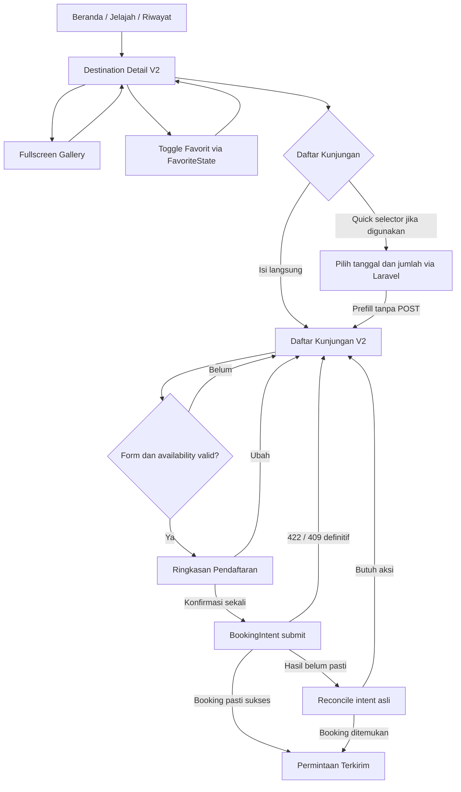

# PRODUCT REQUIREMENTS DOCUMENT (PRD)
## Wisata Daerahku — Destination Detail V2 + Daftar Kunjungan V2

**Nama file:** `PRD-Wisata-Daerahku-Destination-Detail-and-Booking-Experience-V2.md`  
**Target penempatan:** `docs/prd/PRD-Wisata-Daerahku-Destination-Detail-and-Booking-Experience-V2.md` di repository Flutter  
**Versi:** 2.0 — Approved Interactive Wireframes  
**Tanggal:** 3 November 2026  
**Status:** Approved untuk implementasi UI/UX (bukan laporan implementasi selesai)  
**Jenis pekerjaan:** Redesign lintas dua layar, reuse business logic yang sudah ada; backend hanya bila kontrak terbukti belum mencukupi  
**Target utama:** Mobile Flutter Android + Laravel 13 API

---

## 1. Executive Brief & Keputusan Final

Pemilik proyek menyetujui dua interactive wireframe yang dibuat dalam percakapan: **(1) Destination Detail V2 — Immersive Travel Experience** dan **(2) Daftar Kunjungan V2 — Clean & Guided Reservation**. Keduanya harus diwujudkan sebagai satu journey wisatawan yang konsisten, bukan dua demo yang berjalan sendiri-sendiri.

**Keputusan desain yang wajib dipertahankan:**

1. Destination Detail menjadi halaman **full-screen scroll** dengan **full-bleed immersive hero gallery**; bukan detail utama dalam bottom sheet.
2. Galeri menggunakan gambar asli dari Laravel, `sequence`, cover, swipe, indikator jumlah, fullscreen, thumbnail, cache/prefetch/adaptive image variants yang sudah ada.
3. Informasi destinasi ditata sebagai hierarchy editorial: nama, lokasi, rating, kategori/jam, deskripsi expandable, fasilitas dinamis, lokasi, ulasan.
4. Harga ditampilkan dalam **sticky bottom booking bar** sebagai harga **per orang**; tanpa large price card duplikat.
5. CTA **Daftar Kunjungan** mengarah ke flow Booking Experience V2; jika quick selector dipakai, pilihannya diteruskan ke form lengkap tanpa meminta pengguna mengulang pilihan.
6. Booking Experience V2 memakai compact destination preview, unified guest details, kalender bulanan berstatus server, info kuota kontekstual, stepper jumlah orang, catatan opsional, dan **sticky total price + CTA**.
7. Setelah data benar, tampilkan **Ringkasan Pendaftaran** untuk konfirmasi. Kirim booking hanya dari tindakan konfirmasi final; sukses **hanya** setelah Laravel mengembalikan booking pasti dan gunakan layar `PermintaanTerkirimScreen` yang sudah ada.
8. Tidak membuat payment gateway baru dalam pekerjaan ini; DOKU Sandbox + Demo Simulator adalah inisiatif berbeda yang harus tetap kompatibel.
9. **Tanpa QA agent, tanpa perintah menjalankan testing, tanpa full regression, tanpa matriks pengujian, dan tanpa regresi otomatis.** Fokus langsung pada implementasi dan laporan perubahan file.

### 1.1 Rekonsiliasi dua wireframe (penting)

Wireframe Destination Detail menampilkan quick booking bottom sheet (tanggal + jumlah); wireframe Daftar Kunjungan menampilkan form lengkap berisi kalender dan jumlah. Keduanya **bukan dua booking terpisah**:

- CTA detail boleh membuka **Quick Visit Selector** ringan yang mengambil availability nyata, bukan simulasi; tombol **Lanjutkan Pendaftaran** meneruskan `destinationGuid`, `selectedDate`, dan `quantity` ke form `DaftarKunjunganScreen`.
- Sediakan aksi **Isi di Halaman Lengkap** untuk langsung ke form tanpa harus memilih tanggal di selector. Apabila selector dirasa menambah friksi pada implementasi setelah peninjauan struktur widget, default yang diterima adalah CTA **langsung** membuka halaman Daftar Kunjungan V2. Tidak boleh ada dua layar yang mewajibkan pilihan tanggal dan jumlah secara berulang.
- Di halaman penuh, data dari quick selector muncul **prefilled, editable, dan divalidasi ulang terhadap availability server**. Tidak ada `POST /bookings` di quick selector.
- Satu-satunya titik **create booking** adalah tindakan final dari ringkasan, memanggil `BookingIntent` eksisting.

## 2. Konteks, Masalah, dan Riwayat Keputusan

### 2.1 Temuan screenshot awal — detail destinasi

Tampilan lama memperlihatkan visual wisata yang kalah dominan dibanding kartu harga, meta kategori/jam yang berulang, rating bertanda `-` ketika belum ada ulasan, serta lapisan editor Admin/galeri/dialog konflik di belakang sheet detail. Pemilik proyek merasa layout `destination_detail` kurang cocok dan meminta perombakan menyeluruh. Arah yang dipilih adalah **Immersive Travel Experience**, bukan sekadar mengganti padding atau warna.

Screenshot dialog **"Galeri telah berubah"** menunjukkan optimistic concurrency editor galeri Admin. Ini adalah flow editor Admin saat perubahan versi galeri bentrok, **bukan** perilaku visitor detail. Modal konflik tersebut harus tetap berada di dalam konteks editor dan tidak dijadikan elemen detail publik.

### 2.2 Temuan screenshot berikutnya — daftar kunjungan

Tampilan lama memperlihatkan header standar, compact destination card yang perlu ditata ulang, banyak field, kalender tinggi dengan tampilan tanggal yang mirip, pesan kuota berupa peringatan merah besar, stepper, serta catatan opsional. Layout sepanjang itu menyulitkan pengguna memahami ketersediaan tanggal dan biaya. Pemilik proyek kemudian menyetujui **Clean & Guided Reservation**.

### 2.3 Lingkup persetujuan

- Kedua wireframe interaktif disetujui sebagai **acuan UX utama**. Representasi HTML sebelumnya hanya prototipe visual dan tidak menjadi sumber foto, harga, nama, koordinat, tanggal, status, atau kuota produksi.
- Nilai contoh dalam wireframe (Pantai, Tebak, Rp150.000, November 2026, nama/email/telepon demo, kuota ilustratif) **dilarang di-hardcode** sebagai data sebenarnya. Semua harus berasal dari model yang relevan dan Laravel.
- Redesign tidak boleh menghapus fitur lama hanya karena tidak tergambar dalam prototipe, khususnya panel unresolved booking intent, penanganan telepon internasional, error 422/409, session guard, dan feedback server.

## 3. Peninjauan Repository — Baseline Publik

**Flutter:** https://github.com/koyotot/pami-wisata-daearahku  
**Laravel API:** https://github.com/joytimess/pami-wisata-daerahku-api

Peninjauan dilakukan terhadap kode publik branch `main` yang dapat diakses tanggal 3 November 2026. Hash SHA commit paling akhir **tidak dapat dikonfirmasi** dari tampilan riwayat GitHub pada sesi ini; Codex harus membaca checkout lokal terbaru sebelum mengubah file. Jangan menganggap source publik identik dengan perubahan lokal yang belum di-commit.

### 3.1 Flutter — file yang sudah ada dan ditemukan

| File | Yang sudah ada | Instruksi redesign |
|---|---|---|
| `docs/DESIGN.md` | Audit visual dan referensi `design-taste-frontend`; beberapa dokumentasi mencatat arsitektur lama | Baca sebagai landasan bahasa visual; ketika klaimnya usang, **kode aktual** + keputusan V2 lebih mutakhir |
| `lib/screens/detail_wisata_screen.dart` | `DetailWisataScreen`, load detail via `BusinessRepository`, hero, rating/ulasan, favorit, CTA booking | Refactor layout dan hierarchy tanpa mengganti load/network logic |
| `lib/widgets/destination_hero_gallery.dart` | `DestinationHeroGallery`, `FullscreenDestinationGallery`, PageView, indicator, neighbor image prefetch | **Reuse/extend**, jangan membangun galeri duplikat |
| `lib/widgets/api_image.dart` | API image rendering/caching | Reuse image variants; jangan hardcode Unsplash |
| `lib/widgets/reviews_sheet.dart` | Ulasan backend pada bottom sheet | Tetap bisa dibuka dari section inline ulasan/detail |
| `lib/data/favorite_state.dart` | State favorit dan sinkronisasi backend | Jadikan satu sumber kebenaran aksi simpan favorit |
| `lib/screens/daftar_kunjungan_screen.dart` | Form booking, autofill, calendar, quantity, notes, `BookingIntent`, navigasi sukses | Redesign visual, pecah widget seperlunya, jangan rewrite submit logic |
| `lib/widgets/availability_calendar.dart` | Kalender API-aware + timezone + accessible day state | Reuse/refactor dengan month label, level/remaining, legend, and selected UX |
| `lib/widgets/international_phone_field.dart` | Input telepon E.164 dengan pilihan negara | Pertahankan parser, formatter, keyboard-safe UX |
| `lib/data/booking_intent.dart` | Idempotency-Key persisten, reconcile, replay asli, abandon | **Tidak mengubah semantik atau menggandakan booking request** |
| `lib/data/booking_state.dart` | Booking helpers | Reuse existing state dan formatting |
| `lib/data/business_repository.dart` | `Destination`, `DestinationImage`, `Facility`, `MonthlyAvailability`, `AvailabilityDay`, booking/review endpoints | Gunakan DTO yang ada; perubahan hanya jika diperlukan untuk passing state |
| `lib/screens/permintaan_terkirim_screen.dart` | Standalone success screen | Reuse setelah respons server sukses |
| `lib/data/app_data.dart` | `Wisata` dan adaptasi model legacy | Pertahankan GUID dan adapter sesuai kontrak yang ada |
| `lib/services/auth_session.dart` | JWT + session generation | Pertahankan auth/session guard |

### 3.2 Laravel — endpoint dan aturan yang ditemukan

- `GET /api/v1/destinations/{destination}` — detail sumber data destinasi.
- `GET /api/v1/destinations/{destination}/reviews` — ulasan destinasi.
- `GET /api/v1/destinations/{destination}/images/{image}/{variant}` — `thumbnail`, `display`, `fullscreen`.
- `GET /api/v1/destinations/{destination}/availability?month=YYYY-MM&quantity=N` — kalender bulanan **authenticated**, disuplai `QuotaService::monthlyAvailability`.
- `PUT/DELETE /api/v1/favorites/{destination}` — favorit (authenticated).
- `POST /api/v1/bookings` — create booking (authenticated) dengan `Idempotency-Key` dari client.
- `GET /api/v1/booking-intents/{key}` dan `POST /api/v1/booking-intents/{key}/abandon` — resolusi outcome tidak pasti.
- `QuotaService` memberikan `date`, `capacity`, `remaining`, `remaining_percent`, `level`, `status`, `bookable`, `requested_quantity`, dan `timezone`.
- `BookingService` melakukan locking kuota, validasi slot/window, idempotency, snapshot telepon/harga, dan menghasilkan booking state nyata. UI tidak boleh mengambil alih aturan tersebut.

**Policy backend-first:** jangan membuat endpoint/payload/model DB baru untuk kebutuhan yang sudah dilayani kontrak ini. Backend disentuh hanya jika ada kesenjangan yang *terbukti* dari source lokal.

## 4. Tujuan, Prioritas, dan Batasan

### 4.1 Tujuan produk

- Memperkuat storytelling foto destinasi dan CTA kunjungan.
- Mengurangi duplikasi metadata dan meningkatkan keterbacaan informasi.
- Membuat kalender jelas menunjukkan hari yang masih bisa dipesan dan sisa tiket.
- Menjaga alur form tidak berulang, mempermudah input pengunjung, dan menampilkan biaya dengan jelas.
- Menjaga kompatibilitas data bisnis Flutter ↔ Laravel.

### 4.2 In-scope

- Visual UI visitor Destination Detail V2.
- Komponen hero gallery/fullscreen terkait UX; favorite toggle existing.
- Visual UI Daftar Kunjungan V2; kalender, stepper, form, summary, adaptive sticky bottom.
- Quick selector (jika implementasi tidak menduplikasi flow) + initial selection passing.
- Kondisi loading/empty/error/inactive dan integrasi navigasi.
- Pembaruan dokumentasi UI dalam PRD ini atau handoff singkat file berubah.

### 4.3 Out-of-scope (jangan dikerjakan)

- Redesign pengelolaan galeri Admin/Superadmin, upload/reorder/delete/image concurrency `gallery_version`.
- Redesign halaman Beranda, Jelajah, Profil, Notifikasi, Riwayat, login, register, pembayaran, payment-method selector.
- Membuat favorit dan bookmark sebagai dua tabel/sistem baru; tetap satu sistem favorit backend, dengan satu ikon favorit di layar detail.
- Perubahan quota allocation, booking status machine, payment window, webhook, reconciliation behavior server, ticket PDF, check-in, review submission.
- Menambah Firebase database/storage, fake server data, atau library UI besar yang tidak dibutuhkan.
- Deploy, commit, push, migrasi DB dan perubahan scope yang tidak diotorisasi.
- **QA, testing, regresi dan penugasan agent QA tidak termasuk lingkup permintaan ini.**

## 5. Prinsip Desain dan Komposisi Global

1. **`docs/DESIGN.md` menjadi referensi styling utama** bersama pola Flutter visitor terbaru di repo; tidak menganggap catatan arsitektur lama di audit sebagai kode saat ini.
2. Gunakan palet visitor biru/navy/oranye yang telah hadir dalam Flutter; background terang, konten mudah dipindai, surface dan border yang konsisten.
3. Hindari banyak card bertingkat, ornament tidak perlu, gradient berlebihan, dan metadata yang ditampilkan dua kali.
4. Material 3/Plus Jakarta Sans jika memang digunakan oleh desain lokal. Reuse spacing, typography, iconography dan radius dari implementasi aktif.
5. Android **edge-to-edge**, status bar transparan pada hero image, inset top/bottom `SafeArea`, gesture navigation, tidak ada area putih/abu pada tepi status bar saat hero tampil.
6. Floating overlay top action harus kontras terhadap foto terang maupun gelap; gunakan backdrop/scrim yang halus.
7. Komposisi responsif untuk lebar Android kecil hingga besar; hindari overflow ketika font scaling, keyboard, dan bottom gesture bar aktif.
8. Animasi ringan sekitar 200–800ms mengikuti pola existing dan menghormati `MediaQuery.disableAnimationsOf(context)`; jangan membuat loading/heavy visual berlebihan.
9. Copy Bahasa Indonesia, label nonteknis untuk pengguna; error server dipetakan ke pesan yang dapat ditindaklanjuti.
10. Interaksi menggunakan `Semantics`, tooltip/action label, feedback loading dan disabled yang sesuai; bukan cuma mengandalkan warna.

## 6. PRD-A — Destination Detail V2: Immersive Travel Experience

### 6.1 Layout dari atas ke bawah

```text
[Status bar transparan / immersive image behind status bar]
[Back floating]                        [Favorite floating]
┌──────────────── FULL BLEED HERO ────────────────┐
│ Cover/sequence image, swipe horizontal          │
│ Tap -> existing fullscreen + thumbnails         │
│                                      [1 / 10]    │
└────────────── slight content overlap ───────────┘
┌──────────────── Content scroll ─────────────────┐
│ Eyebrow (opsional dari kategori; jangan fake)    │
│ Nama Destinasi              ★ 4.8 / Belum dinilai│
│ 📍 Lokasi singkat                                │
│ [Kategori] [Jam operasional]                    │
│                                                 │
│ Tentang Destinasi                               │
│ Deskripsi singkat ... [Baca selengkapnya]       │
│                                                 │
│ Fasilitas Tersedia                              │
│ [Fasilitas dinamis dari API]                    │
│                                                 │
│ Lokasi Destinasi                                │
│ [Alamat/lokasi nyata; peta jika ada koordinat]  │
│                                                 │
│ Ulasan Pengunjung [Lihat Semua]                 │
│ [Rating & ulasan aktual / empty state]          │
└─────────────────────────────────────────────────┘
┌───────── Sticky bottom booking bar ─────────────┐
│ Harga per orang        [Daftar Kunjungan →]     │
└─────────────────────────────────────────────────┘
```

### 6.2 Hero dan galeri

- Hero sekitar 42–52% tinggi viewport sesuai aspect ratio foto/device, full width, gambar di belakang transparent status bar, transisi ke konten radius top besar. **Bukan** bottom sheet utama.
- `Destination.images` harus tetap sorted by `sequence` (angka terkecil cover). `images` array dari Laravel dan fallback legacy hanya menurut aturan model existing; jangan menebak gambar lain.
- Swipe carousel menggunakan PageView, count `current/total`, dot indicators secukupnya; untuk 1 gambar sembunyikan navigasi yang tidak relevan.
- Tap foto masuk `FullscreenDestinationGallery` existing, halaman fullscreen dengan thumb rail, current index dan back yang mengembalikan selected image ke hero.
- Gunakan `display` untuk hero, `fullscreen` untuk fullscreen, `thumbnail` untuk thumbnail; adaptive image/cache/prefetch existing tidak hilang.
- 0 foto: placeholder destinasional elegan + teks seperlunya. Gambar gagal: placeholder/retry yang tidak menghilangkan konten atau CTA.
- Update gambar dari Admin saat user membuka ulang/detail refresh: urutan dan cover mengikuti payload paling mutakhir, bukan cache foto lama yang dipaksakan.

### 6.3 Top actions

- Back kembali ke asal navigasi (Beranda/Jelajah/Riwayat jika valid).
- Satu **Favorite** floating icon (outline vs filled) memakai `FavoriteState.instance`, loading busy state dan error message. **Hapus duplikasi tombol simpan/bookmark di bawah** sehingga tidak ada dua tombol berbeda untuk satu data favorit.
- Anonymous/unverified/session-invalid tidak boleh melakukan mutasi favorit; arahkan ke auth/verification sesuai guard existing, bukan state lokal yang berbohong sukses.

### 6.4 Info destinasi

- Nama `Destination.name` dan lokasi dari API, ellipsis/wrap yang benar.
- Rating bila `rating_count > 0` tampil nilai `rating_average` (format satu desimal) + jumlah ulasan. Bila belum ada rating tampil **"Belum dinilai"**, jangan `★ -`.
- Kategori dari `category`, bukan label hardcoded; jam dari `opening_hours`, satu kali saja di metadata compact chip.
- Deskripsi dari `description`; default ringkas dengan kontrol `Baca selengkapnya`/`Tampilkan lebih sedikit` bila panjang. Saat kosong, hide/empty descriptive state tanpa contoh copy palsu.
- Fasilitas dari `Destination.facilities` (relation API), icon by `icon_key` bila tersedia. Tidak membuat daftar fasilitas statis/palsu; jika kosong tampil teks informatif kecil.
- Lokasi menggunakan `location` yang tersedia. **Jangan tampilkan peta dekoratif atau pin palsu** jika backend tidak menyediakan koordinat/URL peta yang dapat dipertanggungjawabkan. Bila tidak ada koordinat, cukup card lokasi textual. Jika suatu saat tersedia, map CTA boleh menggunakan lokasi asli.
- Ulasan inline: summary rating/count dan cuplikan bila data aktual tersedia; `Lihat semua` reuse `ReviewsSheet` existing (atau presentation baru atas state yang sama), termasuk loading/error/empty.

### 6.5 Sticky booking bar

- Kiri: `Harga tiket / orang` dan formatted `IDR` dari `ticket_price` + `currency` (Rp150.000, bukan `IDR150000`). Harga `0` ditampilkan sesuai kebijakan produk (mis. `Gratis`) hanya jika API memang nol.
- Kanan: CTA utama `Daftar Kunjungan` menggunakan flow pada Bagian 8.
- Tetap terlihat selama content scroll, tidak menutupi section terakhir; tambahkan bottom scroll padding dan inset gesture bar.
- Destinasi/nonaktif atau data invalid: jangan melakukan submit; tampilkan state CTA yang benar dan alasan, bukan tetap lanjut ke booking yang tidak valid.

### 6.6 Detail state matrix

| Kondisi | Hasil yang wajib ditampilkan |
|---|---|
| Initial fetch | Skeleton/placeholder layout konsisten, CTA tidak menipu |
| Destination success | Galeri, identitas, fasilitas, review, harga dari API |
| No image | Hero placeholder, tanpa `1/0` |
| One image | Single hero, count/dots disederhanakan |
| Multi image (hingga batas editor aktif) | Swipe, count, fullscreen, thumbnails/sequence |
| No ratings | `Belum dinilai`, bukan tanda minus |
| No description/facilities/reviews | Empty states seperlunya; jangan fake value |
| API fetch failure | Error contextual + action retry, aman kembali |
| Favorite mutation in progress/failure | One active action, busy state, restore server truth |
| Inactive destination/category | Tidak membuka create booking; state informative |
| Slow/missing image | Konten dan CTA tetap usable |
| System back/fullscreen close | Kembali ke foto/scroll position yang masuk akal |

## 7. PRD-B — Daftar Kunjungan V2: Clean & Guided Reservation

### 7.1 Informasi dan layout

```text
[Status bar normal, solid light surface]
[Back]           Daftar Kunjungan
                  Lengkapi detail perjalananmu
┌─────────────────────────────────────────────────┐
│ [Thumbnail] Pantai                              │
│             📍 Lokasi                           │
│             [Jam] [Kategori]                    │
│             Rp150.000 / orang                   │
└─────────────────────────────────────────────────┘
│ Data Pengunjung                                │
│ [Nama Lengkap]                                  │
│ [🇮🇩 +62 ▼ | Nomor Nasional]                    │
│ [Email]                                         │
│                                                 │
│ Tanggal Kunjungan                              │
│ [◂]       November 2026         [▸]             │
│ Sen Sel Rab Kam Jum Sab Min                      │
│ [calendar cells showing availability]           │
│ [Legend]                                        │
│ [Date status + remaining / guidance]            │
│                                                 │
│ Jumlah Pengunjung                              │
│ [Ticket]           [-] 1 [+]                    │
│                                                 │
│ Catatan Tambahan (opsional)                    │
│ [Textarea]                                      │
┌──────────── Sticky bottom ──────────────────────┐
│ Estimasi Total     Tanggal terpilih             │
│ Rp150.000          7 Nov 2026                   │
│ [Tinjau Pendaftaran →]                          │
└─────────────────────────────────────────────────┘
```

### 7.2 Compact destination preview

- Thumbnail dari gambar cover `Destination.images.first`, bukan screenshot editor atau mockup.
- Nama, lokasi, kategori, jam, dan harga per orang dibuat ringkas dengan line wrapping adaptif.
- Tidak melakukan fetch destinasi berulang yang tidak diperlukan jika data detail sudah tersedia; jika refresh diperlukan, satu sumber data `BusinessRepository`.
- Apabila data harga dari cache berbeda dengan hasil backend saat booking dibuat, server total_amount tetap otoritatif; jangan membuat klaim harga pasti sebelum booking sukses.

### 7.3 Data pengunjung

- Prefill `Nama Lengkap`, `Nomor Telepon`, dan `Email` dari user aktif. Pengunjung boleh mengubah untuk booking saat ini.
- Phone field **satu row terintegrasi**: flag, kode internasional, separator, placeholder nomor nasional. Reuse `InternationalPhoneField`/`parseBookingPhone`, lalu kirim `visitor_phone` E.164 ke Laravel.
- Nomor pengunjung merupakan **booking snapshot**, bukan perintah update profil. Backend existing boleh mengisi `users.phone` **hanya ketika field profil kosong**, sesuai business rule yang telah ada.
- Validasi nama, email, phone tetap mempertahankan validasi form dan API 422. Pesan error muncul dekat field terkait; jangan hanya global snackbar.
- `Email` tetap dinamis dari profil tapi editable, tanpa melonggarkan auth/verification constraint.
- Saat keyboard muncul, field fokus tetap terlihat, form bisa scroll, sticky bar tidak menutup keyboard dan input.

### 7.4 Kalender availability bulanan

**Sumber data dan otoritas:** `BusinessRepository.monthlyAvailability(destinationGuid, month, quantity)`; kalender tidak menghitung sendiri booking allocation, tidak membuat kuota acak, dan tidak mengandalkan waktu HP untuk menentukan hak booking.

- Header bulan dalam Bahasa Indonesia (mis. `November 2026`), tombol sebelum/sesudah dengan kontrol batas masuk akal. **Jangan** mengunci navigasi menjadi 3 bulan hanya karena prototype HTML mendemokan 3 bulan; patuhi batas backend/product existing.
- Grid tujuh kolom, Senin–Minggu; tanggal di tengah, whitespace memadai, radius konsisten, ring selected biru jelas.
- Informasi per hari wajib mempertimbangkan **`status`, `level`, `remaining` dan `bookable`** dari API; warna hanya pelengkap, bukan satu-satunya informasi.
- **Important nuance:** status `low`/`Hampir penuh` dapat tetap **bookable** selama `status=available` dan kuota mencukupi. Jangan menyamakan warna merah/low dengan sold-out yang tidak dapat dipilih.
- Legend memakai label backend yang tepat: banyak tersedia (`high`), terbatas (`medium`), hampir penuh (`low`), belum tersedia/tutup/habis (status eksplisit). Jika ruang layar sempit, legenda menjadi baris wrapped atau grid kecil yang rapi.
- `remaining` dapat null pada `unconfigured`; tampil `—`/status, **bukan** angka 0 hasil asumsi.
- `requested_quantity` harus cocok dengan jumlah orang saat ini sebelum CTA aktif. Setiap perubahan month atau quantity memicu validasi ulang, menonaktifkan CTA selama request relevan loading, dan mengabaikan respons yang stale.
- Waktu lokal berdasarkan `MonthlyAvailability.timezone`/destinasi; contoh Asia/Jakarta tidak boleh menjadi hardcode universal jika destinasi lain berzona berbeda. Ikuti util `destinationCalendarNow()` dan server booking windows.
- Memilih hari yang `bookable=true` mengisi pilihan dan menunjukkan status + sisa tiket. Hari `sold_out`, `closed`, `unconfigured`, `unavailable`, `insufficient_quantity` tidak boleh di-submit dan memberi penjelasan yang manusiawi apabila diinspeksi.
- Hari lalu, hari terlalu dekat, atau jendela belum buka/tutup harus ikut state server. Jangan mengasumsikan semua tanggal masa depan otomatis bisa dipesan.
- Jika tanggal telah dipilih tetapi quantity berubah dan menjadi tidak cukup: pertahankan konteks pilihan dengan penanda invalid + ajakan mengurangi quantity/pilih tanggal lain, atau sesuaikan hanya bila pengguna diberi feedback eksplisit; **jangan menyelundupkan booking dengan jumlah berbeda dari yang dilihat pengguna**.
- Selama loading/error, jangan menampilkan kuota lama sebagai bookable. Retry memuat data tanpa membuang input nama/phone/email/catatan.

#### 7.4.1 Mapping status API ke UI (jangan disederhanakan secara salah)

| Data dari API | Status presentasi | Interaksi |
|---|---|---|
| `status=available`, `level=high` | Hijau / banyak tersedia | Selectable |
| `status=available`, `level=medium` | Amber / terbatas | Selectable |
| `status=available`, `level=low` | Merah/oranye / hampir penuh | **Selectable**, bila quantity sesuai |
| `status=sold_out` / remaining=0 | Habis | Not selectable |
| `status=unconfigured` | Belum ada kuota | Not selectable |
| `status=closed` | Pendaftaran ditutup/belum masuk window | Not selectable |
| `status=unavailable` | Tidak tersedia | Not selectable |
| `status=insufficient_quantity` | Sisa kurang untuk quantity terpilih | Not selectable untuk quantity itu; arahkan kurangi tiket |
| Null/not returned/loading/error | Tidak diketahui/belum dimuat | Not selectable; tidak direka |

### 7.5 Stepper jumlah pengunjung

- Minimum 1; maksimum mengikuti aturan booking aktual di backend dan sisa kuota. **Jangan menganggap maksimal 10 sebagai aturan backend** hanya karena prototype dibatasi 10.
- Unit label: `n orang`, harga satuan dari API, estimasi total dari harga satuan × jumlah (format IDR lokal).
- Plus/minus memakai state quantity tunggal, mengirim monthly availability request baru sesuai quantity. Tombol disabled saat menyentuh batas yang valid.
- Setelah perubahan quantity, tanggal yang sudah terpilih tetap terlihat tetapi wajib dievaluasi terhadap respons availability baru sebelum CTA bisa aktif.

### 7.6 Catatan opsional

- Tampilkan textarea dengan placeholder kontekstual; `notes` tetap opsional dan tidak mengubah bentuk request.
- Gunakan batas karakter hanya jika sesuai rule backend/validation existing; jangan menambah hard limit arbitrer dari HTML demo.

### 7.7 Sticky bottom summary

- Bar bottom dengan `Estimasi Total`, harga terformat, tanggal terpilih, dan CTA.
- Tanpa tanggal valid: CTA dapat menuntun scroll ke kalender dengan label `Pilih Tanggal Kunjungan`, **tidak mengirim booking**.
- Dengan tanggal valid + data valid + availability terkini: CTA `Tinjau Pendaftaran` membuka langkah ringkasan.
- Dengan unresolved intent atau request in flight: CTA submit dinonaktifkan dan panel recovery lebih diprioritaskan.
- Bar menyesuaikan `SafeArea` Android serta keyboard; tidak menimpa textarea atau fokus form.

## 8. Journey & Navigasi End-to-End



### 8.1 Prefill quick selector ke full form

- Jika memakai quick selector, kirim `initialDate` dan `initialQuantity` **tanpa membuat booking baru**. `DaftarKunjunganScreen` saat ini punya `initialDate` (disebut untuk test) tetapi belum menyediakan `initialQuantity`; tambahkan interface aman seperlunya pada screen/route, tanpa mengubah payload booking atau `BookingIntent`.
- Saat form dibuka, lakukan fetch `MonthlyAvailability` dengan destination/month/quantity tersebut dan verifikasi `bookable`. Jika tidak tersedia lagi, pertahankan tanggal sebagai context, tampilkan informasi, dan minta pilihan lain.
- Draf form jangan hilang saat kembali dari Ringkasan. Jika kembali ke Detail, perilaku Back mengikuti navigasi normal dan tidak submit.

### 8.2 Ringkasan Pendaftaran — langkah nyata

- Konten: destinasi, tanggal kunjungan, jumlah pengunjung, nama, kontak, catatan bila ada, harga satuan dan **estimasi** total.
- Aksi `Ubah Data` kembali ke form dengan state utuh.
- Aksi `Kirim Permintaan Kunjungan` memanggil **satu** `BookingIntent.submit(...)` untuk data final.
- Saat submit: one-flight, disable duplicate taps, jaga scroll/route dan session-generation safeguards.
- **Jangan** navigasi ke success dari tombol tanpa respons pasti; success berasal dari `Booking` sukses ataupun `IntentCompleted` hasil reconcile.
- Setelah server sukses, gunakan existing `PermintaanTerkirimScreen` **standalone tanpa back/nav**, dengan CTA Riwayat dan Beranda. Jangan buat success screen demo baru sebagai produksi.

### 8.3 Status booking dan pembayaran

- `Permintaan Terkirim` hanya berarti booking sudah dibuat di backend, **bukan pembayaran berhasil atau konfirmasi Admin selesai**.
- Status yang benar harus dipakai dari Laravel dan tetap konsisten dengan booking approval, payment expiration (bila adapter diintegrasikan nanti), dokumen/inbox/notification existing.
- Proyek merencanakan **DOKU Sandbox + Demo Simulator** pada pekerjaan terpisah; halaman ini tidak boleh menampilkan metode pembayaran palsu atau mengambil alih gateway flow.

## 9. Kondisional Wajib dan Error Handling

| Kondisi | UX dan aturan |
|---|---|
| Visitor detail belum termuat | Loading/skeleton, jangan hitung harga atau galeri dari data palsu |
| Destinasi dihapus/dinonaktifkan | Informasikan dan hentikan booking baru, sediakan Back |
| Image sequence kosong/satu/banyak | Placeholder / single hero / swipe+count+fullscreen |
| Galeri editor Admin conflict | Tetap confined ke editor; `gallery_version` bukan state visitor |
| Favorit belum di-load | State belum pasti, hindari indikator favorit yang mengklaim kondisi salah |
| Favorit gagal disimpan | Error + reload/sync server truth |
| User belum login/tidak verified | Ikuti existing auth/verification route; jangan create booking |
| Form invalid | Inline feedback untuk nama, email, E.164 phone; input tetap utuh |
| Kuota belum dikonfigurasi | Status belum tersedia, tidak bisa dipesan; jangan diasumsikan 0 kuota aktual |
| Kuota penuh | Hari nonbookable dan pesan pilih tanggal lain |
| Booking window belum dibuka/tutup | Nonbookable meskipun remaining > 0 |
| Quantity > remaining | Berikan pesan sesuaikan quantity, tidak submit |
| Availability sedang loading/error | CTA gated, retry yang tidak mereset seluruh form |
| Quantity/bulan berubah cepat | Abaikan stale response untuk bulan/quantity lama |
| Zona waktu destinasi berbeda dari device | Tanggal dan close window mengikuti destinasi/server |
| Harga berubah setelah layar dibuka | Total UI estimasi; total server pada booking adalah otoritas |
| API 422 | Field errors dekat field relevan, jangan hapus draft |
| API 409 | Refresh availability; tampilkan konflik kuota dan/atau resolusi intent sesuai error existing |
| Timeout/network drop setelah POST | Status outcome dianggap tidak pasti; simpan intent asli, **tidak auto-POST lagi** |
| Intent unresolved | Panel `Periksa hasil`, `Kirim ulang` **hanya bila replay-safe**, `Batalkan percobaan` sesuai existing; blokir booking baru |
| Session user berubah/logout saat async | Jangan menampilkan data user lama atau navigasi sukses lintas akun |
| Keyboard dan gesture bar aktif | Sticky bar tidak menutupi konten/input, safe area adaptif |
| Reduced motion | Non-essential animation dimatikan |
| Android back dari summary | Kembali ke form tanpa kehilangan draft; tidak melakukan POST |

### 9.1 Idempotency tidak boleh rusak

- `BookingIntent` menyimpan `Idempotency-Key` + **payload identik** sebelum request dan hanya menghapus setelah outcome konklusif atau user abandon.
- Unknown outcome tidak boleh di-retry otomatis dengan key baru.
- Jangan mengubah user input yang sudah dikirim pada retry stored attempt. Perubahan form hanya menjadi booking baru **setelah** intent sebelumnya selesai/abandoned sesuai server.
- Jangan membuat handler submit kedua dari quick selector, ringkasan dan form yang masing-masing bisa membuat booking.

### 9.2 Catatan status availability

`level=low` di respons Laravel menandakan **hampir penuh** dan dapat tetap berstatus `available`. `sold_out` adalah status tersendiri. UI harus mempertahankan perbedaan itu meskipun prototype HTML menggunakan empat kategori warna sederhana.

## 10. Kontrak Data — Tanpa Endpoint Baru Default

### Destination

`guid`, `name`, `description`, `location`, `ticket_price`, `currency`, `opening_hours`, `timezone`, `category`, `rating_average`, `rating_count`, `facilities[]`, `images[]`, `gallery_version`, `is_active`.

### Image

`guid`, `sequence`, `urls.thumbnail`, `urls.display`, `urls.fullscreen`.

### Availability

Request: `GET destinations/{guid}/availability?month=YYYY-MM&quantity=N` (Bearer session valid). Response: `destination_guid`, `month`, `timezone`, `requested_quantity`, `dates[{date,capacity,remaining,remaining_percent,level,status,bookable}]`.

### Booking create

`POST bookings` with existing `BookingIntent` and `Idempotency-Key`. Existing payload: `destination_guid`, `visit_date`, `quantity`, `visitor_name`, `visitor_email`, `visitor_phone` (E.164), `notes`.

**Jangan** mengirim field `price`, `total`, atau `availabilityStatus` sebagai kebenaran bisnis. Backend adalah pemilik aturan kuota dan harga.

## 11. Rekomendasi Arsitektur Flutter dan File Kandidat

### Kandidat utama (wajib ditinjau sebelum edit)

```text
lib/screens/detail_wisata_screen.dart
lib/screens/daftar_kunjungan_screen.dart
lib/widgets/destination_hero_gallery.dart
lib/widgets/availability_calendar.dart
lib/widgets/international_phone_field.dart
lib/widgets/api_image.dart
lib/widgets/reviews_sheet.dart
lib/data/business_repository.dart
lib/data/app_data.dart
lib/data/favorite_state.dart
lib/data/booking_intent.dart        # read/reference first, modify only if proven essential
lib/data/booking_state.dart
lib/services/auth_session.dart      # read/reference first, preserve session semantics
lib/screens/permintaan_terkirim_screen.dart # reuse, no redesign
lib/theme/app_colors.dart           # compare active palette before changes
lib/main.dart                       # only for required system UI/navigation changes
```

### Widget baru hanya jika benar-benar meningkatkan modularitas

- `lib/widgets/destination_info_section.dart` — optional.
- `lib/widgets/destination_booking_bar.dart` — optional.
- `lib/widgets/visit_booking_summary.dart` — optional.
- `lib/widgets/quick_visit_selector.dart` — optional, jika quick selector dipakai.
- `lib/widgets/booking_guest_details.dart` — optional.

**Aturan:** jangan create satu file untuk tiap dekorasi kecil. Utamakan ekstraksi reusable section yang benar-benar diperlukan. Jangan menggandakan state API atau `PageController` yang sudah punya owner.

### Backend — hanya bila ada gap faktual

```text
routes/api.php
app/Http/Controllers/Api/V1/DestinationController.php
app/Http/Controllers/Api/V1/QuotaController.php
app/Http/Controllers/Api/V1/BookingController.php
app/Services/QuotaService.php
app/Services/BookingService.php
app/Http/Resources/* (hanya resource terkait)
```

Tidak ada alasan default untuk mengubah model, migration, controller, route, atau database hanya demi layout V2.

## 12. Peran Agents & Skills — Mode Hemat Usage

**Preferensi pemilik proyek:** sebelumnya orkestrasi 7 agents menghabiskan usage; PRD ini menggunakan **sedikit agent dengan ownership jelas**, tanpa fan-out, tanpa bolak-balik orchestration.

| Agent / skill | Status dalam PRD ini | Tugas |
|---|---|---|
| **`flutter_engineer`** (`C:\Users\itsba\.codex\agents\flutter_engineer.toml`) | **PRIMARY / WAJIB** | Implementasikan kedua layar, widget/flow, edge-to-edge, navigation, responsive, data-binding, error UI |
| **`backend_engineer`** | **KONDISIONAL** | Hanya bila kode membuktikan endpoint/field relevan tidak tersedia; berikan perubahan paling kecil |
| **`system_architect`** | **KONDISIONAL / konsultasi tunggal** | Jika ada konflik desain antara quick selector, state form, dan server contract; bukan agent aktif default |
| **`master_orchestrator` / "ponytails"** | **KOORDINASI MINIMAL / opsional** | Jika digunakan, cukup sekali menetapkan task & ownership, tidak memecah menjadi banyak delegasi |
| **`security_auditor`** | **TIDAK DIDELEGASIKAN** | Tidak ada security audit terpisah untuk scope visual ini; guard existing tetap wajib dipertahankan oleh implementer |
| **`qa_engineer`** | **TIDAK DIDELEGASIKAN** | Tidak ada tugas QA, testing, atau regression dalam brief ini |
| **`design-taste-frontend`** | **SKILL REFERENSI DESAIN** | Bila tersedia lokal, baca prinsip visual/hierarchy/responsiveness dan `docs/DESIGN.md`; tidak membuat flow redesign lain |
| Skills Flutter/mobile lain yang benar-benar **tersedia lokal** | **OPSIONAL, RELEVAN SAJA** | Discover skill yang terinstal terlebih dahulu, pakai hanya yang langsung berkaitan; jangan mengarang nama skill |

**Aturan eksekusi:** satu `flutter_engineer` mengerjakan UI end-to-end. Backend baru dilibatkan **jika benar-benar perlu**. Tidak ada spawning massal agents, no QA agent, no test authoring, no full suite/lint sweep sebagai aktivitas scope ini.

## 13. Urutan Implementasi untuk Codex

1. Baca `docs/DESIGN.md`, source Flutter terakhir, serta model/backend routes/availability yang relevan. Pertahankan perubahan lokal pengguna.
2. Catat gap nyata antara existing behavior dan approved wireframes; rencanakan change set terbatas.
3. Implement Destination Detail V2 memakai gallery widget existing, data asli, inline info, favorite tunggal, sticky booking bar.
4. Implement integrasi CTA; pakai quick selector hanya jika prefill ke full screen bersih, tanpa mengulang booking.
5. Implement Daftar Kunjungan V2: compact header/card, guest fields, calendar availability statuses, stepper, notes, bottom pricing bar.
6. Tambahkan real summary step yang tidak membuat booking sebelum konfirmasi final.
7. Hubungkan konfirmasi final ke **existing `BookingIntent`**, success ke **existing `PermintaanTerkirimScreen`**; pertahankan unresolved intent flow.
8. Rapikan state UI: loading/empty/error/unauthorized/stale, keyboard insets, safe area, reduced motion, semantik interaction.
9. Laporkan file yang berubah dan keputusan penting. Tidak perlu menjalankan QA/testing/regresi, tidak perlu meminta persetujuan tambahan untuk detail visual dalam batas brief.

## 14. Kriteria Hasil yang Harus Terlihat (Definition of Done — Implementasi, bukan Test Plan)

- Destination detail berwujud immersive full-bleed full-screen page, bukan bottom sheet detail.
- Gallery sequence/fallback/thumb/fullscreen memakai API dan widget existing.
- Satu aksi favorite canonical dan konsisten dengan state Laravel.
- Harga per orang hanya punya satu representasi dominan di sticky booking bar.
- Nama/lokasi/rating/kategori/jam/deskripsi/fasilitas/reviews tampil dari data nyata dan states yang relevan.
- Booking V2 menggunakan compact destination preview, data kontak editable dengan kode negara, kalender quota-aware, stepper, catatan, dan sticky total.
- `level=low` tidak salah dianggap sold-out; status `bookable` jadi sumber kebenaran.
- Pilihan dari quick selector (jika ada) diteruskan sebagai prefill ke form, divalidasi ulang server, bukan sebagai booking.
- Ringkasan memperlihatkan data yang sama dengan submit final. Satu konfirmasi → satu `BookingIntent`.
- Hanya server-confirmed success yang menuju `PermintaanTerkirimScreen`.
- Unknown POST outcome/409/422 dan session-change guard lama tidak hilang.
- Tidak ada endpoint database baru, payment flow palsu, admin gallery changes, atau scope meluas.
- Tidak ada bagian QA, testing, regression, agent QA, atau hasil tes yang diklaim dalam laporan implementasi.

## 15. Final Constraints / Larangan Keras

1. **Jangan** buat ulang arsitektur Flutter/Laravel.
2. **Jangan** memutus `BookingIntent`, idempotency/reconcile, quota concurrency, E.164 parsing atau session generation.
3. **Jangan** mengganti gallery sequence/caching dengan static image asset/mock photo.
4. **Jangan** hardcode Pantai, Tebak, Rp150.000, November 2026, fasilitas atau data user demo.
5. **Jangan** mengganti `PermintaanTerkirimScreen` menjadi layar mock local-success.
6. **Jangan** menambah sistem favorit/bookmark baru atau menggandakan tombol favorite.
7. **Jangan** mengintervensi alur Admin/Superadmin ataupun konflik `gallery_version`.
8. **Jangan** buat DOKU payment workflow di dalam PRD UI ini; biarkan integrasi berikutnya memakai existing booking.
9. **Jangan** memanggil/menulis QA testing, regression, suite, atau mendelegasikan `qa_engineer`.
10. **Jangan** buat commit/push/deploy kecuali diminta terpisah.

## 16. Source References (titik awal Codex)

- Flutter repository: https://github.com/koyotot/pami-wisata-daearahku
- Laravel repository: https://github.com/joytimess/pami-wisata-daerahku-api
- Flutter desain: https://github.com/koyotot/pami-wisata-daearahku/blob/main/docs/DESIGN.md
- Flutter detail: https://github.com/koyotot/pami-wisata-daearahku/blob/main/lib/screens/detail_wisata_screen.dart
- Flutter booking: https://github.com/koyotot/pami-wisata-daearahku/blob/main/lib/screens/daftar_kunjungan_screen.dart
- Flutter gallery: https://github.com/koyotot/pami-wisata-daearahku/blob/main/lib/widgets/destination_hero_gallery.dart
- Flutter availability: https://github.com/koyotot/pami-wisata-daearahku/blob/main/lib/widgets/availability_calendar.dart
- Flutter booking intent: https://github.com/koyotot/pami-wisata-daearahku/blob/main/lib/data/booking_intent.dart
- Laravel API routes: https://github.com/joytimess/pami-wisata-daerahku-api/blob/main/routes/api.php
- Laravel quota: https://github.com/joytimess/pami-wisata-daerahku-api/blob/main/app/Services/QuotaService.php
- Laravel booking: https://github.com/joytimess/pami-wisata-daerahku-api/blob/main/app/Services/BookingService.php

---

**Final brief:** Implementasi terpadu dua wireframe yang telah disetujui, bergaya travel premium namun konsisten dengan Wisata Daerahku, berlandaskan `docs/DESIGN.md` dan kode aktual; hanya perubahan UI/UX serta wiring terbatas, mempertahankan seluruh business logic dan kondisional backend yang telah berjalan. **Tanpa QA/testing/regresi.**
